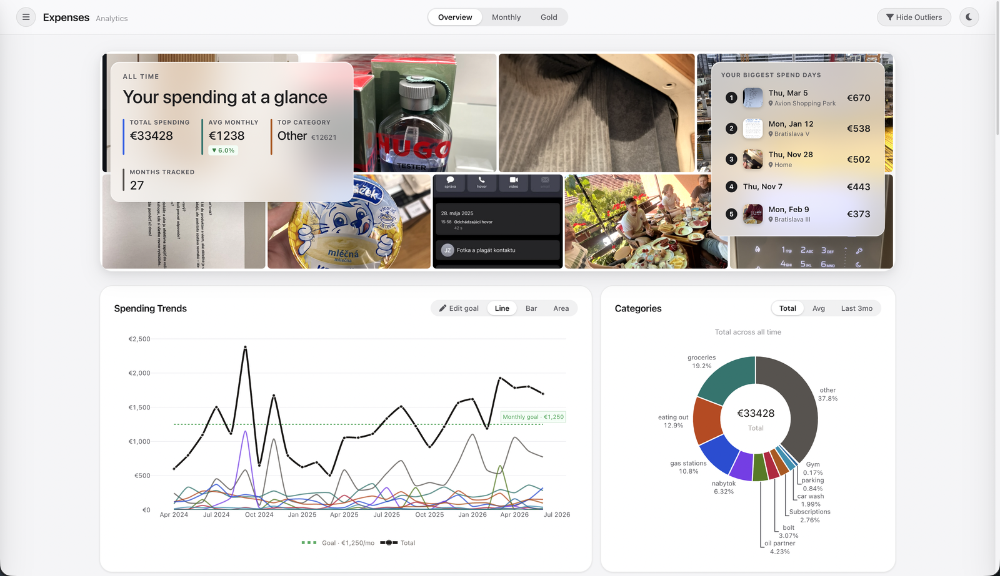
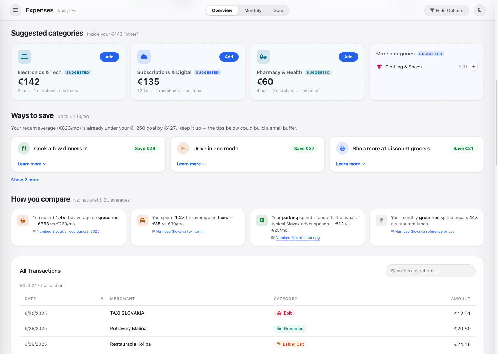
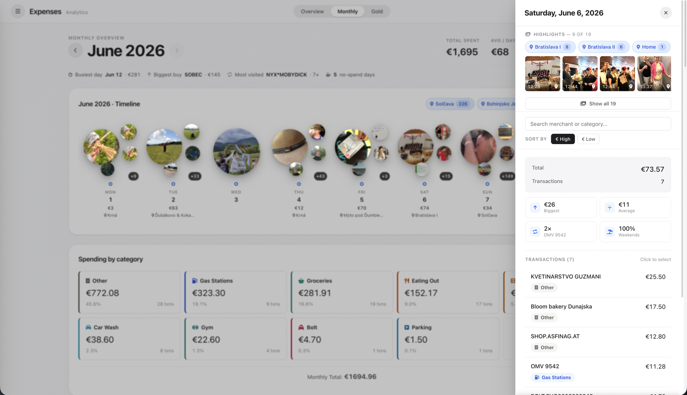
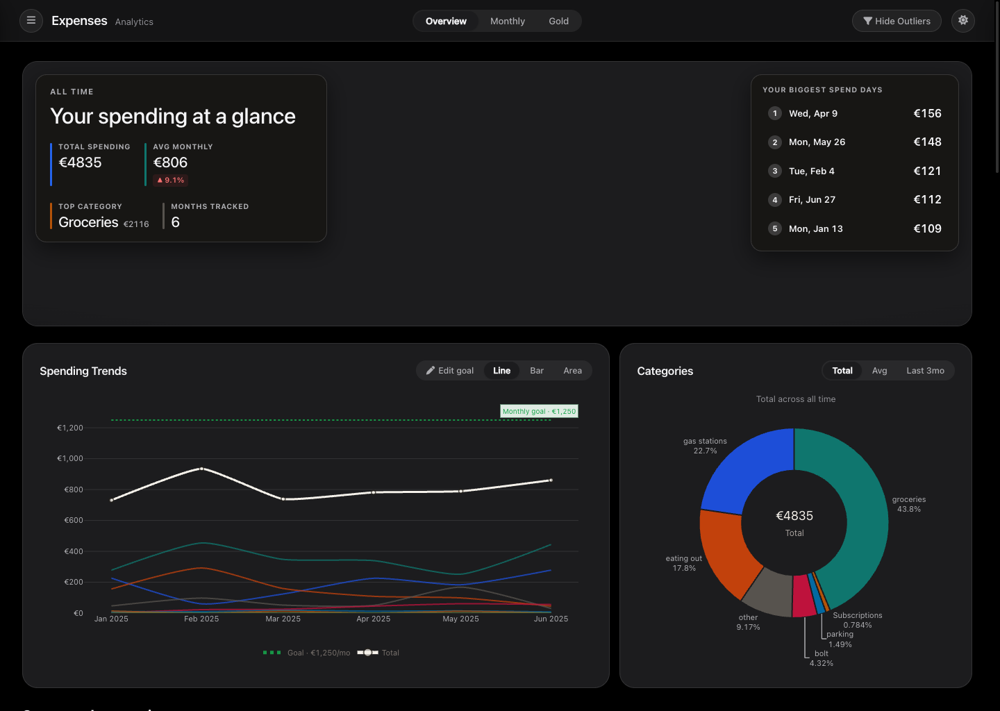
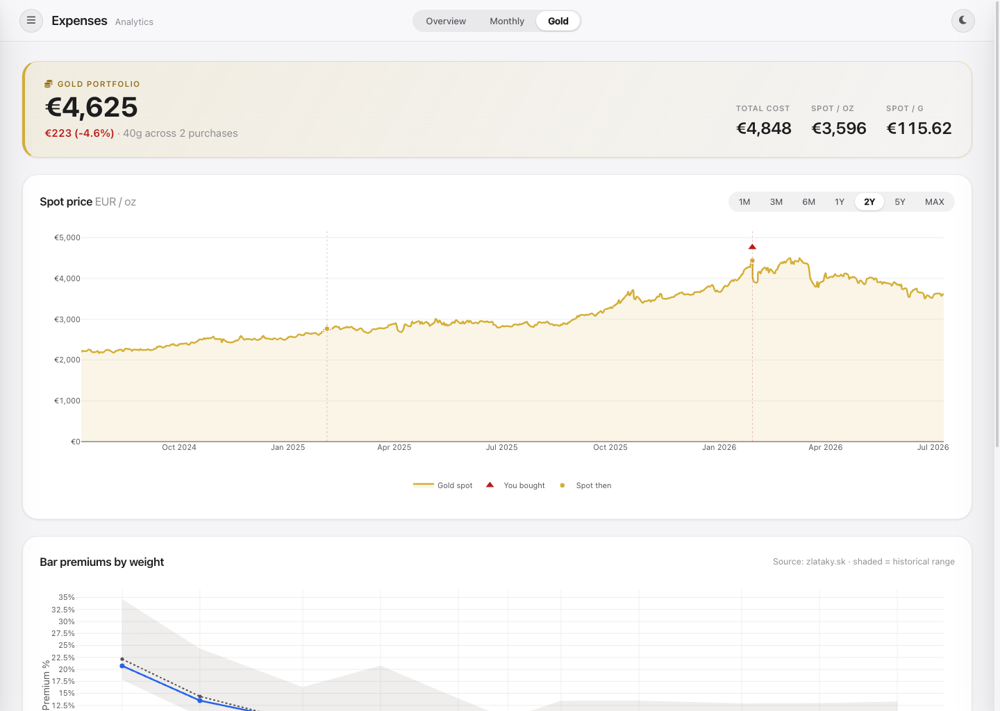

<p align="center">
  
</p>

<h1 align="center">Expenses</h1>

<p align="center">
  <em>Your card statements, turned into a spending dashboard you'll actually open.</em>
</p>

<p align="center">
  
  
  
  
  
</p>

<p align="center">
  <strong>Drop in a CSV export → get monthly trends, category breakdowns, savings ideas, and (on a Mac) the photos from your biggest-spend days.</strong><br>
  <sub>No account, no cloud, no API keys. Everything runs on your machine and your data never leaves it.</sub>
</p>

---

You export a year of card transactions. It's a wall of rows — `LIDL 042`, `SHELL 8257`, `GOOGLE*YOUTUBEPREMIUM` — and you have no idea where the money actually went.

**Expenses** reads that CSV and turns it into something you'd want to look at: where your money goes, how it trends month over month, which categories are quietly creeping up, and concrete ways to spend less. It even pulls photos from your phone's library to remind you what a big-spend day *was*.

No setup ceremony. Clone it, point it at a CSV (or click **"Explore with sample data"**), and open your browser.

---

## Quick start

The easiest way is [**uv**](https://docs.astral.sh/uv/) — one command installs Python, the deps, and runs the app, from inside the `expenses/` directory:

```bash
uv run app.py
```

That's it. `uv` reads `pyproject.toml`, creates an isolated environment, installs everything, and starts the server. (Don't have uv? `curl -LsSf https://astral.sh/uv/install.sh | sh` — or on Windows `powershell -c "irm https://astral.sh/uv/install.ps1 | iex"`.)

<details>
<summary>Prefer classic pip + venv?</summary>

```bash
python3 -m venv .venv        # Windows: py -m venv .venv
source .venv/bin/activate    # Windows: .venv\Scripts\Activate.ps1
pip install -r requirements.txt
python app.py
```

</details>

Then open **<http://localhost:5001>**.

The first time you open it with no data, hit **Explore with sample data** to try everything instantly with bundled synthetic exports — zero setup required.

---

## What you get

| | |
|---|---|
| **Spending at a glance** | All-time total, monthly average with trend, top category, and your biggest-spend days — in one hero card. |
| **Trends & categories** | Interactive line / bar / area charts, a drag-to-set monthly budget goal, and a category donut you can slice into. |
| **Suggested categories** | The app mines your `Other` bucket and proposes real categories (Pharmacy, Clothing, Electronics…) — one click to create and back-fill them. |
| **Ways to save** | Actionable, sourced tips computed from *your* numbers ("Drive in eco mode", "Fill up at cheaper stations") with an estimated €/month saving each. |
| **How you compare** | Your spend vs. national / EU averages, every figure linking out to its source. |
| **Monthly deep-dive** | Per-month hero, category cards, daily-spending bars, and photo memories from that month. |
| **Gold tab** *(optional)* | Live gold spot price, bar premiums, and a portfolio tracker — for the gold-hoarders among us. |
| **Light & dark** | A full Apple-style redesign — translucent materials, SF typography, spring motion — in both themes. |

<p align="center">
  
</p>

The **monthly deep-dive** breaks a single month down by category and day, and clicking any day (or a photo) opens a side panel with that day's transactions and pictures:

<p align="center">
  
</p>

Everything works in **dark mode** too:

<p align="center">
  
</p>

And there's an optional **Gold** tab — live spot price, bar premiums, and a portfolio tracker:

<p align="center">
  
</p>

---

## Three questions everyone asks

### "Does my bank work?"

Out of the box the parser reads the **Tatra banka "Export pohybov"** CSV layout — rows with these fixed columns:

| Position | Column | Example |
|---:|---|---|
| 0 | Transaction type | `Debet` |
| 2 | Amount in EUR | `12.50` |
| 6 | Date (`DD.MM.YYYY`) | `05.03.2026` |
| 10 | Merchant name | `LIDL 042 BA` |

Different bank, different layout? Two options: **convert your export** into that column order (a spreadsheet or a tiny script does it), or just click **Explore with sample data** for a full demo with no data at all. Your real files go in `expense_reports/` — git-ignored, always private.

*(Exporting from Tatra banka: app → **Pohyby na karte** → top-right icon → pick a cycle → **Export → CSV** → find it in **Messages** → download → upload. The in-app welcome screen walks you through it.)*

### "Windows, or just Mac?"

The core app is plain **Python + Flask + a browser** — it runs on **Windows, macOS, and Linux**. Only the optional Photos "memories" feature is macOS-specific, and it turns itself off everywhere else.

### "Will the Photos feature work on my computer?"

That feature reads your local **macOS Photos** library to show pictures next to your biggest-spend days. It only activates on **macOS with a Photos library present** — everywhere else it silently returns nothing and the rest of the dashboard works exactly the same. You never need photos to use the app.

---

## How it works

```
CSV export ─▶ parse & auto-categorise ─▶ aggregate (month × category)
                                              │
        ┌─────────────────────┬───────────────┼───────────────────┐
        ▼                     ▼               ▼                   ▼
   trends & donut      suggested cats     savings engine     photo memories
   (Plotly)            (merchant mining)  (local rules +      (macOS Photos,
                                           benchmark KB)       optional)
```

Everything is deterministic and local — the savings recommendations and category suggestions are a rules engine over a small built-in knowledge base, **not** an LLM call. Nothing phones home.

---

## Project layout

```
expenses/
├── app.py                   # Flask app factory (port 5001)
├── credit_card_expenses.py  # CSV parser + auto-categoriser
├── pyproject.toml           # Python deps (uv / PEP 621) — requirements.txt also provided
├── start_dashboard.sh/.bat  # Run scripts (prefer uv, fall back to python)
├── blueprints/              # HTTP routes: expenses, gold, photos
├── services/                # Domain logic: aggregation, insights, photos, gold
├── static/                  # Vanilla-JS + CSS frontend (no build step)
├── templates/dashboard.html
├── sample_reports/          # Bundled synthetic demo data (committed)
└── expense_reports/         # Your real CSV exports (git-ignored, private)
```

---

## Tips

- **Add data any time** — drop CSVs in `expense_reports/`, or use the upload button in the sidebar (**☰**).
- **Categories** are keyword-based; edit the `CATEGORIES` dict in `credit_card_expenses.py`, or reclassify any transaction in the UI (it remembers the merchant).
- **Track your own gold** — create `data/gold_purchases.json` (a list of `{"date","weight_g","price_eur","label"}`) or set `GOLD_PURCHASES_JSON`.
- **Port in use?** Change the port at the bottom of `app.py`.
- **Charts blank?** They load Plotly / Font Awesome from a CDN — you need a connection for that.

---

<p align="center"><sub>Built for people who want to understand their spending without handing it to a third party.</sub></p>
